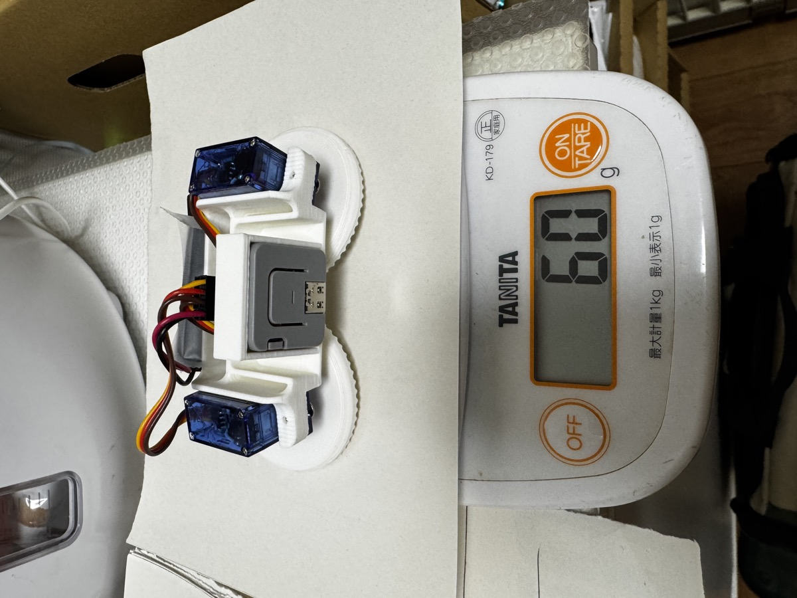
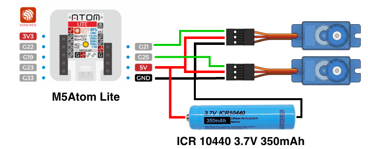
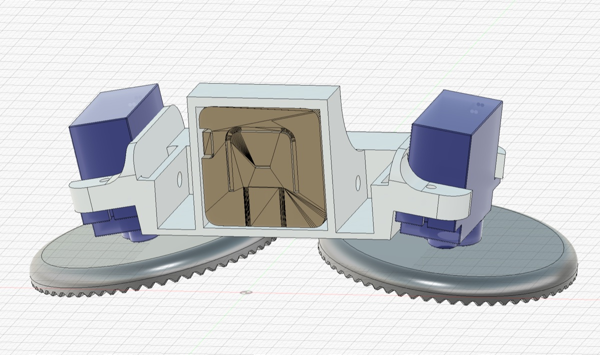

# MiniKawa_B_pad — M5Atom Lite Bluetooth Gamepad Robot

**English** | [日本語](README.ja.md)

A two-wheeled differential-drive robot built from an M5Atom Lite and two continuous-rotation servos, driven with a Bluetooth gamepad.
Gamepad connectivity is handled by [Bluepad32](https://github.com/ricardoquesada/bluepad32).



This robot was built with the code in this repository and has been driven with an 8BitDo Micro. It weighs **about 60 g** in total.


https://github.com/user-attachments/assets/f6fcd470-5445-4eaf-9e9e-97b3e650eb28


## Build overview

1. Gather the [parts](#parts)
2. Set up the development environment on your PC ([Build and upload](#build-and-upload))
3. **Change the gamepad restriction in `include/config.h` to match your own gamepad** ([important](#set-up-for-your-own-gamepad-required))
4. Upload the firmware and test with only the servos connected, before assembly ([Wiring](#wiring) / [Pairing](#pairing))
5. Assemble the chassis ([Assembly](#assembly))
6. Tune the driving direction and straight-line tracking ([Tuning](#tuning-includeconfigh))

## Parts

| Part | Notes |
|---|---|
| M5Atom Lite | Original ESP32 (supports Bluetooth Classic). AtomS3 models will not work |
| Continuous-rotation servo ×2 | FS90R, SM-S4303R, etc. (stops at 1500 µs) |
| Bluetooth gamepad | 8BitDo (Micro, etc.), Xbox, PS4/PS5, Switch Pro, Joy-Con, etc. [Supported gamepads](https://bluepad32.readthedocs.io/en/latest/supported_gamepads/) |
| Battery | The robot in the photo uses **one 10440 lithium-ion cell (3.7 V)** with a battery holder. If you use 4×AA (about 6 V), do not connect it to the Atom's 5V pin; power the Atom from USB-C or another 5 V source instead. Be sure to read [About the battery](#about-the-battery-10440-lithium-ion-cell) |
| Frame ×1, wheels ×2 | 3D-printed parts. Files are in the [`3d/`](3d/) folder (see [3D-printed parts](#3d-printed-parts)) |
| Jumper wires / pin headers | To connect the servo plugs to the Atom's side header |
| USB-C cable | For uploading (must support data) |

## Wiring



```
M5Atom Lite (side header)  Left servo        Right servo
  G21 ---------------------- Signal (orange/white)
  G25 -------------------------------------- Signal (orange/white)
  GND -------+-------------- GND (brown/black) -- GND (brown/black)
             |
10440 - -----+
10440 + -----+-------------- +V (red) ------ +V (red)
             |
  5V  -------+
```

- A single 10440 cell powers **both servos and the Atom itself**. Connect the battery + to the Atom's 5V pin and to the servos' +V (red); connect the battery − to the Atom's GND and to the servos' GND (brown).
- Take the servos' + **directly from the battery**. Feeding the servos through the Atom's 5V pin (i.e. through the Atom's board) can cause resets from insufficient current.
- The Atom, battery and servos **must share a common GND**.
- If you wire left and right the other way round, just swap `PIN_SERVO_LEFT` / `PIN_SERVO_RIGHT` in `config.h`.

> [!CAUTION]
> **This power setup is from the first test build and is very likely not appropriate.**
> Connecting a 3.7 V lithium-ion cell directly to the Atom's 5V pin is outside what the M5Atom Lite is designed for (5 V input). It worked on the robot in the photo, but its safety and long-term reliability have not been tested. Consider a more appropriate setup, such as adding protection circuitry or a boost converter (e.g. a 5 V boost module), or a circuit that switches between battery and USB power. If you use this setup as a reference, you do so at your own risk.

> [!WARNING]
> **About USB-C**
>
> - **Always remove the battery before connecting a USB-C cable.** This applies to uploading, using the serial monitor and powering from USB alike.
> - In this wiring, the battery + is connected directly to the Atom's 5V pin. If you connect USB with the battery in place, USB 5 V may flow through the 5V pin **straight into the lithium-ion cell, with no charge control.** This can cause overheating, swelling or fire.
> - Conversely, the battery voltage may also reach the USB side (e.g. your PC's USB port).
> - If you want to run the robot on USB power, also remove the battery first. Because the servos' + is also connected to the 5V pin in this wiring, the servos draw current from USB while it is connected. Driving the robot can then cause resets from insufficient current or strain your PC's USB port, so do not drive the robot while it is powered from USB.
> - It is a good idea to make the battery easy to remove, using a holder or a connector.

## Assembly

This is how the robot in the photo is built.

### 3D-printed parts

The [`3d/`](3d/) folder contains the files for the robot in the photo (Mk5).



The M5Atom Lite fits into the central frame, with a servo fixed on each side. The servos and wheels are mounted at an angle, so the wheels are tilted inward at the top (cambered).

### Tilted wheels (rocking-chair design)

This robot stands on **just two wheels**, with no caster or support wheel. It does not fall over because the wheels are **mounted at a tilt**.

- A tilted disc wheel touches the floor at a single point on its rim. When the robot leans forward or backward, that contact point moves along the rim.
- Just like the runners of a rocking chair, the contact point shifts toward the side the robot leans to, producing a force that brings the center of gravity back. The posture is therefore stabilized **by the mechanism alone, without sensors or control** (the rocking-chair effect).
- The lower the center of gravity, the more stable it is.

This approach was used in **TOPO**, a home robot released by Androbot in the early 1980s, among others. Androbot called this drive and stabilization system **Andromotion**.

| File | Contents | Qty | Size (mm) |
|---|---|---|---|
| [`Mk5_Frame.3mf`](3d/Mk5_Frame.3mf) | Body frame (Atom holder + servo mounts) | 1 | 80 × 34 × 28 |
| [`mk5_Wheel.3mf`](3d/mk5_Wheel.3mf) | Wheel (knurled rim) | **2** | 50 dia. × 5 thick |
| [`MiniKawa_Mk5.f3z`](3d/MiniKawa_Mk5.f3z) | Fusion 360 design file (for editing) | — | — |

- Open the `.3mf` files in a slicer (Bambu Studio, PrusaSlicer, Cura, etc.) and print. Print two wheels.
- If your servos or battery have different dimensions, you can open the `.f3z` file in Fusion 360 and modify it.

### Assembly tips

- **Frame**: The M5Atom Lite fits into the central holder, with one servo fixed on each side. Mount the servos as mirror images, with their output shafts facing outward (this is why the left servo is inverted by default).
- **Wheels**: Disc-shaped wheels screwed directly onto the servo horns. A knurled rim helps them grip the floor.
- **Battery**: One 10440 cell. It is much lighter than 4×AA, which is what keeps the whole robot at about 60 g.
- **Wiring**: Route the servo cables over the frame and bundle them near the Atom's side header. Secure them so they cannot get caught in the wheels.
- **Ground contact**: No support wheel or caster is needed. The robot stands on its two [tilted wheels](#tilted-wheels-rocking-chair-design) alone. Check that the frame does not touch the floor.
- Mounting the Atom so that its USB-C port and button are easy to reach makes uploading and toggling the drive lock easier.

Before assembly, pair the gamepad and test with the servos connected on your desk; this makes problems much easier to isolate.

## About the battery (10440 lithium-ion cell)

The robot in the photo uses **one 10440 lithium-ion cell** to power both the servos and the Atom.
A 10440 cell is almost the same size as an AAA battery (10 mm diameter × 44 mm long), but it is a **lithium-ion cell with a voltage of 3.7 V** (about 4.2 V when fully charged). Its small size and low weight suit a robot of this size.

- Its voltage is lower than the rating of most servos (4.8–6 V), so speed and torque are somewhat lower than with 4×AA (about 6 V). The robot in the photo drives fine at this voltage.
- As the battery runs down (around 3.3 V as a guide), the servos slow down and the Atom becomes more likely to reset. Recharge it when the robot gets sluggish.

> [!WARNING]
> **A 10440 cell is the same size as an AAA battery, but it is a completely different, special-purpose battery. Handle it with great care.**
>
> - **Never use it in place of an AAA battery in other devices.** A device designed for AAA (1.5 V) would receive more than twice its intended voltage and could be damaged or overheat. They are hard to tell apart by sight, so do not store them together with AAA batteries.
> - **Charge it only with a dedicated charger for lithium-ion cells (3.7 V / 4.2 V).** Never charge it in a NiMH charger.
> - **Do not short-circuit it.** A large current can flow, with a risk of overheating and fire. Do not carry bare cells together with metal objects (keys, coins, tools, etc.).
> - **Do not over-discharge it.** Leaving it fully drained degrades it and can make recharging dangerous. When not in use, remove the cell and store it at around half charge. Choosing a cell with a built-in protection circuit is safer.
> - **Do not insert it with reversed polarity.** Check the polarity of the battery holder with a multimeter or similar before wiring.
> - If you notice **swelling, deformation, abnormal heat or an unusual smell**, stop using it immediately and dispose of it according to your local regulations (lithium-ion batteries must not go in general waste).
> - Do not leave it unattended while charging or driving, and keep it away from flammable materials.
> - If children are using the robot, an adult should handle charging and inserting/removing the battery.

## Build and upload

This project uses PlatformIO. Bluepad32 is distributed as a custom Arduino core with the Bluetooth stack built in, so `platformio.ini` replaces the framework of the official espressif32 platform with the Bluepad32 version.

1. Install the [PlatformIO IDE extension](https://platformio.org/install/ide?install=vscode) in [VS Code](https://code.visualstudio.com/) (or install the command-line PlatformIO Core)
2. Clone this repository and open the folder in VS Code
3. Complete "Set up for your own gamepad" below
4. Connect the Atom over USB-C and upload

```sh
pio run -t upload
pio device monitor
```

The first build takes a while because it downloads the Bluepad32 Arduino core.
If uploading fails, try lowering `upload_speed` in `platformio.ini` to `115200`.

### Set up for your own gamepad (required)

`include/config.h` restricts connections to the author's own gamepad (one specific 8BitDo Micro). **As shipped, any other gamepad is disconnected immediately after connecting.** Remove the restriction first.

```cpp
constexpr uint16_t GAMEPAD_ALLOWED_VID = 0;  // 0 = no restriction
constexpr uint16_t GAMEPAD_ALLOWED_PID = 0;  // 0 = no restriction
#define GAMEPAD_ALLOWED_ADDR ""              // empty string = no restriction
```

When a gamepad connects, its VID / PID / addr are printed to the serial monitor. If you want to lock the robot to your gamepad so that other people's gamepads cannot connect, write those values back and upload again.

## Pairing

1. Power on the robot (the LED **blinks blue**).
2. Put the gamepad into pairing mode.
   - **8BitDo Micro**: Set the mode switch to **S** (Switch) or **D** (D-input) and hold the pair button
   - Xbox: Hold the pair button on top
   - PS4/PS5: Hold SHARE (Create) + PS
   - Switch Pro: Hold the sync button on top
3. Once connected, the LED turns **green** and the gamepad vibrates briefly (rumble-capable gamepads only).

After that, just turn the gamepad on and it reconnects. To switch to a different gamepad, **hold the Atom's button for 3 seconds** to clear the pairing information (the LED flashes white briefly).

## Controls

| Input | Action |
|---|---|
| Left stick up/down | Forward / backward |
| Right stick left/right (or left stick left/right) | Turn |
| D-pad | Forward/backward/left/right (diagonals curve) |
| A (bottom button) | Cycle speed level 35% → 65% → 100% (longer rumble at higher levels) |
| B (right button) | Emergency stop while held |
| Atom button, short press | Drive lock ON/OFF (LED red and no movement while ON) |
| Atom button, long press (3 s) | Clear pairing information |

Button names follow the Xbox layout. On Switch-style and 8BitDo gamepads the printed labels may be swapped, so set `DEBUG_PRINT_GAMEPAD 1` to check which buttons actually register as A/B.
Gamepads in keyboard mode also work: arrow keys/WASD to drive, Space/Enter to change speed, Esc to stop.

The robot stops immediately if the gamepad disconnects.

## Tuning (`include/config.h`)

- **Drives in the wrong direction / one wheel reversed** → `SERVO_INVERT_LEFT` / `SERVO_INVERT_RIGHT`
- **Servos creep slowly when stopped** → with `SERVO_RELEASE_ON_STOP = true` (default), pulses are stopped while idle
- **Does not drive straight** → compensate the left/right speed difference with `SERVO_TRIM_*_US`
- **Too twitchy / too sluggish** → `ACCEL_PER_SEC`, `TURN_GAIN`, `SPEED_LEVELS`
- **Check that input is arriving** → `DEBUG_PRINT_GAMEPAD 1` prints stick and button values to serial

## Troubleshooting

| Symptom | What to check |
|---|---|
| Gamepad connects but drops immediately | The `GAMEPAD_ALLOWED_VID` / `PID` / `ADDR` restriction ([Set up for your own gamepad](#set-up-for-your-own-gamepad-required)) |
| LED keeps blinking blue and never connects | Is the gamepad in pairing mode? If it was paired before, hold the Atom's button for 3 s to clear pairing and try again |
| Atom resets when the robot starts moving | Are the servos powered through the Atom? Battery level (recharge the 10440) |
| Servos do not move at all | Is GND shared? Signal pins (G21 / G25). Is the LED red (drive lock on)? |
| Goes backward when driving forward / spins in place | `SERVO_INVERT_LEFT` / `SERVO_INVERT_RIGHT` |

## File structure

```
platformio.ini        Build settings (Bluepad32 Arduino core)
3d/                   3D-printed parts (.3mf) and Fusion 360 design file (.f3z)
docs/images/          Photos and wiring diagram for the README
include/config.h      Pin, servo and driving settings
src/main.cpp          Driving logic, Atom button, LED
src/gamepad.*         Bluepad32 wrapper (connection management, input normalization)
src/servo_drive.*     Continuous-rotation servo control and differential drive
```
